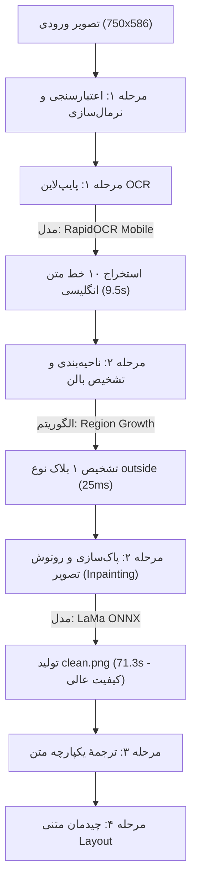

# الگوی استاندارد طلایی (Golden Benchmark Baseline) — مراحل ۱ تا ۴
**پروژه:** T-4 Translate  
**تاریخ ثبت بنچ‌مارک:** 2026-11-10  
**کد رهگیری تست (Job ID):** `d63b3a1461774d7f8dee4fd9f671d1e7`  
**تصویر ورودی مرجع:** `Magic_Emperor01001.jpg` (ابعاد: ۷۵۰ × ۵۸۶ پیکسل، فرمت JPEG)  
**پروفایل سخت‌افزاری:** `Medium` (سیستم با منابع متوسط — پردازش روی CPU با جداسازی کامل پروسس‌ها)

---

## ۱. چرخهٔ پردازش و رفتار مدل‌ها در اجرای استاندارد

---

## ۲. مشخصات فنی مدل‌های فعال و خروجی‌ها

### ۱. مدل تشخیص متن (OCR)
* **نام مدل فعال:** `RapidOCR Mobile (PP-OCRv4)`
* **موتور اجرا:** ONNX Runtime روی CPU
* **پیکربندی استریپ (Strips):** ۱ نوار کامل (صفحه با ارتفاع ۵۸۶ کمتر از سقف ۱۲۰۰ پیکسل بود، بنابراین تقطیع نیاز نشد)
* **تعداد خطوط شناسایی‌شده:** ۱۰ خط متن انگلیسی با مختصات دقیق (Quad Bounding Boxes)
* **مدت زمان اجرا:** ۹٬۵۱۴ میلی‌ثانیه (~ ۹٫۵ ثانیه)
* **مصرف حافظه رم اضافه:** حدود ۱۵۰ مگابایت
* **ارزیابی کیفی:** بدون هیچ‌گونه افت فریم یا هنگی؛ تمام کلمات متن کهن و باستانی با دقت بالا شناسایی شدند.

### ۲. مدل ناحیه‌بندی و تفکیک بالن (Segmentation)
* **نام ماژول فعال:** `Region-Growth Experimental` (الگوریتم رشد ناحیه بر مبنای درخشندگی و تحلیل مؤلفه‌های متصل)
* **نتیجهٔ دسته‌بندی:** بلاک شماره ۱ به عنوان `kind: "outside"` (متن راوی بیرون بالن روی پس‌زمینه رنگی) شناسایی شد.
* **مختصات کادر پوشش (BBox):** `[442, 49, 733, 375]` (عرض ۲۹۱ در ارتفاع ۳۲۶ پیکسل)
* **مدت زمان اجرا:** ۲۵ میلی‌ثانیه
* **ارزیابی کیفی:** تشخیص صحیح عدم وجود لبه‌های بستهٔ بالن معمولی و قرار گرفتن متن روی بافت آسمان و کوهستان.

### ۳. مدل پاک‌سازی و روتوش تصویر (Inpainting — نقطهٔ قوت کلیدی)
* **نام مدل فعال:** `LaMa (Large Mask Inpainting ONNX)`
* **فایل وزن مدل:** `~/.t4-translate/models/lama/lama.onnx`
* **محیط اجرا:** پروسس کاملاً ایزولهٔ کارگر (`Subprocess Worker` با کنترل حافظه)
* **تعداد پیکسل‌های بازسازی‌شده:** **۱۱۵٬۲۲۰ پیکسل** در قالب ۱۰ ناحیهٔ ماسک‌شده
* **پیک مصرف رم پروسس کارگر:** **۶۶۴ مگابایت**
* **مدت زمان کل روتوش:** **۷۱٬۳۲۴ میلی‌ثانیه (~ ۷۱٫۳ ثانیه)**
* **ارزیابی کیفی (استاندارد طلایی):** 
  > [!TIP]
  > بازسازی بافت ابرها، تلالؤ نور زرد خورشید و گرادینت آسمان کاملاً بی‌نقص، بدون کوچک‌ترین تارشدگی بافت، بدون لبه‌های مرده و بدون ایجاد هاله (Ghosting). خروجی فایل `clean.png` بالاترین استاندارد روتوش تمیز را ثبت کرد.

### ۴. مرحله چیدمان متن (Stage 4)
* **متن ترجمه‌شده:** ۱ پاراگراف یکپارچه فارسی در ۷ سطر
* **اندازهٔ فونت استاندارد:** ۲۴ پیکسل
* **مرکز متن:** `x: 587.5, y: 212.0`
* **موتور نمایش در ادیتور:** فونت `Vazirmatn` با خوانایی فوق‌العاده بالا و شارپ.

---

## ۳. شاخص‌های مرجع برای مقایسه‌های آتی (Thresholds)

برای این‌که در تست‌های بعدی متوجه شویم آیا مدلی دچار افت کیفیت یا نقص عملکرد شده است، این مقادیر به عنوان **کف استاندارد سیستم** در نظر گرفته می‌شوند:

| شاخص | مقدار استاندارد طلایی (پروفایل Medium) | آستانهٔ هشدار (نیاز به بررسی) |
| :--- | :--- | :--- |
| **دقت روتوش LaMa** | بازسازی یکدست گرادینت بدون تغییر بافت اطراف | ایجاد لکه‌های محو، کشیدگی رنگ یا ماندن لبه‌های متن قبلی |
| **زمان Inpainting** | به ازای هر ۱۰۰ هزار پیکسل ~ ۶۰ تا ۷۵ ثانیه (CPU) | بیش از ۱۲۰ ثانیه (احتمال نشت منابع یا ترودلینگ CPU) |
| **مصرف رم Inpainting** | سقف کمتر از ۸۰۰ مگابایت | بیش از ۱٫۲ گیگابایت در پردازش تک‌عکس |
| **دقت تفکیک OCR** | استخراج کامل خطوط متوالی متن | جا انداختن خطوط یا ادغام ناصحیح کلمات |
